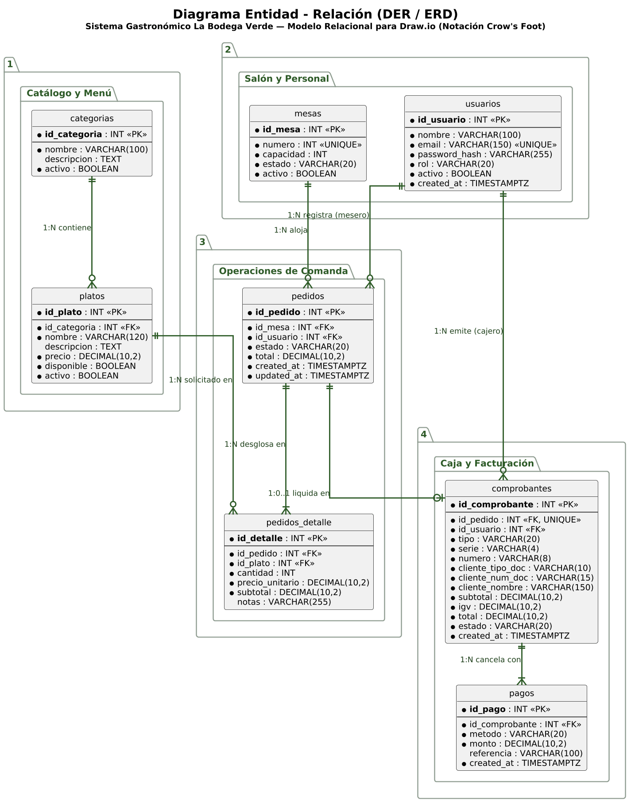

# 🌿 Diagrama Entidad - Relación (DER / ERD) para Draw.io
## Sistema Gastronómico — La Bodega Verde

Este documento contiene el **Diagrama Entidad - Relación** preparado específicamente para **Draw.io** (app.diagrams.net), utilizando la notación relacional estándar de **Pata de Gallo (*Crow's Foot*)**.

---

## 1. Imagen Renderizada en Alta Resolución

> **Archivos generados en tu proyecto:**
> - 🖼️ **Imagen PNG de alta resolución:** [`diagrama_er_drawio.png`](file:///C:/Users/marti/Documents/Ciclo%209/Servicios%20Cloud/diagrama_er_drawio.png)
> - 📄 **Archivo editable para Draw.io:** [`diagrama_er_bodega_verde.drawio`](file:///C:/Users/marti/Documents/Ciclo%209/Servicios%20Cloud/diagrama_er_bodega_verde.drawio)
> - 💻 **Script de importación SQL directa:** [`drawio_sql_import.sql`](file:///C:/Users/marti/Documents/Ciclo%209/Servicios%20Cloud/drawio_sql_import.sql)

---

## 2. Tres Formas de Usarlo en Draw.io

### Opción A: Abrir el archivo `.drawio` directamente (Recomendada)
1. Entra a [draw.io (app.diagrams.net)](https://app.diagrams.net).
2. Haz clic en **Archivo (File) > Abrir desde (Open From) > Dispositivo (Device)** (o simplemente arrastra el archivo sobre la ventana del navegador).
3. Selecciona el archivo: [`diagrama_er_bodega_verde.drawio`](file:///C:/Users/marti/Documents/Ciclo%209/Servicios%20Cloud/diagrama_er_bodega_verde.drawio).
4. El diagrama se cargará con todas las tablas agrupadas, colores temáticos de *La Bodega Verde*, campos PK/FK y conectores Crow's Foot listos para mover y editar.

---

### Opción B: Generación automática mediante SQL en Draw.io (En 10 segundos)
Draw.io cuenta con una función nativa para crear diagramas ER pegando sentencias `CREATE TABLE`:
1. En Draw.io, ve al menú superior: **Organizar (Arrange) > Insertar (Insert) > Avanzado (Advanced) > SQL**.
2. Copia y pega el contenido del archivo [`drawio_sql_import.sql`](file:///C:/Users/marti/Documents/Ciclo%209/Servicios%20Cloud/drawio_sql_import.sql).
3. Presiona el botón azul **"Insertar" (Insert)**.
4. Draw.io dibujará instantáneamente todas las tablas y sus claves foráneas en el lienzo.

---

### Opción C: Copiar y pegar la imagen en Word, PowerPoint o Draw.io
Si solo necesitas insertar el diagrama visual en tu informe o diapositivas:
- Inserta directamente la imagen [`diagrama_er_drawio.png`](file:///C:/Users/marti/Documents/Ciclo%209/Servicios%20Cloud/diagrama_er_drawio.png), renderizada a 150 DPI para máxima nitidez de texto y líneas.

---

## 3. Diccionario de Entidades y Cardinalidades

| Módulo | Entidad | Atributos Clave | Relaciones y Cardinalidad (Crow's Foot) |
| :--- | :--- | :--- | :--- |
| **Catálogo y Menú** | `categorias` | `id_categoria (PK)`, `nombre`, `descripcion`, `activo` | `categorias (1)` --- `(0..N) platos` |
| | `platos` | `id_plato (PK)`, `id_categoria (FK)`, `nombre`, `precio`, `disponible` | `platos (1)` --- `(0..N) pedidos_detalle` |
| **Salón y Personal** | `mesas` | `id_mesa (PK)`, `numero (UNIQUE)`, `capacidad`, `estado`, `activo` | `mesas (1)` --- `(0..N) pedidos` |
| | `usuarios` | `id_usuario (PK)`, `nombre`, `email (UNIQUE)`, `rol`, `activo` | `usuarios (1)` --- `(0..N) pedidos` *(Mesero)* `usuarios (1)` --- `(0..N) comprobantes` *(Cajero)* |
| **Operaciones** | `pedidos` | `id_pedido (PK)`, `id_mesa (FK)`, `id_usuario (FK)`, `estado`, `total` | `pedidos (1)` --- `(1..N) pedidos_detalle` `pedidos (1)` --- `(0..1) comprobantes` |
| | `pedidos_detalle` | `id_detalle (PK)`, `id_pedido (FK)`, `id_plato (FK)`, `cantidad`, `precio_unitario` | Entidad asociativa comanda-plato. |
| **Facturación** | `comprobantes` | `id_comprobante (PK)`, `id_pedido (FK)`, `tipo`, `serie`, `numero`, `total` | `comprobantes (1)` --- `(1..N) pagos` |
| | `pagos` | `id_pago (PK)`, `id_comprobante (FK)`, `metodo`, `monto`, `referencia` | Permite pagos mixtos (Efectivo + Yape). |
