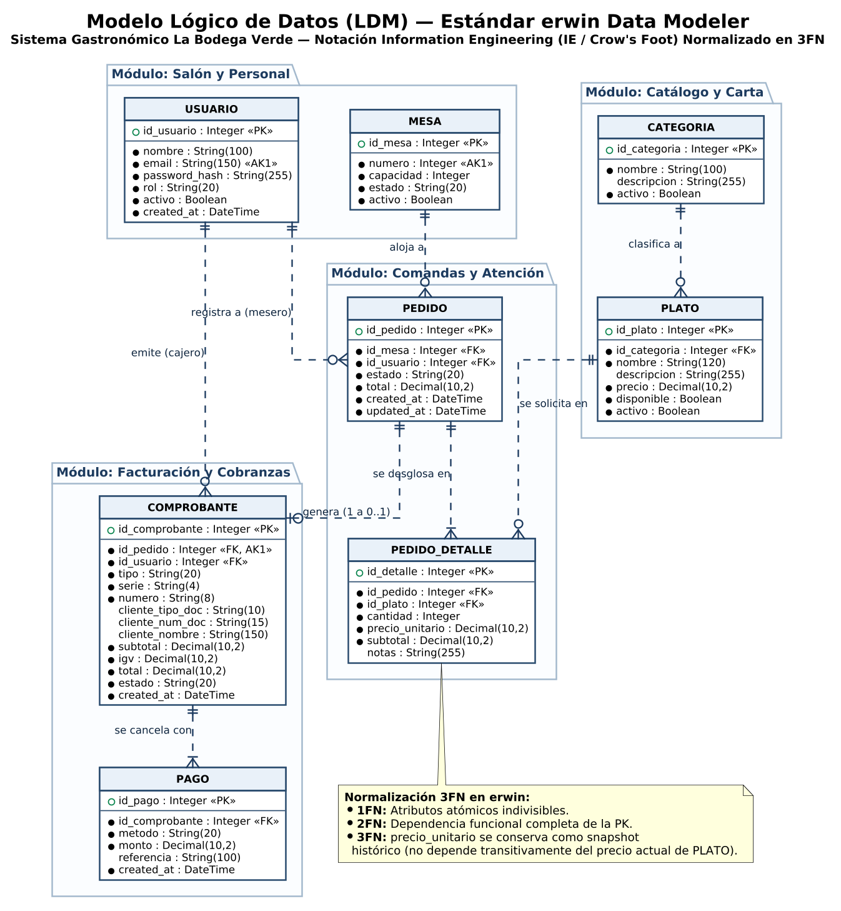

# 📘 Guía Paso a Paso: Construcción del Modelo Lógico en erwin Data Modeler
## Sistema Gastronómico — La Bodega Verde

Esta guía detalla el procedimiento exacto para modelar el **Esquema Relacional Lógico (LDM)** normalizado en **Tercera Forma Normal (3FN)** utilizando el software profesional **erwin Data Modeler**, según los estándares académicos universitarios.

---

## 1. Imagen del Diagrama Lógico (Estándar erwin)

> **Archivos generados en tu proyecto:**
> - 🖼️ **Imagen PNG de alta resolución (160 DPI):** [`diagrama_logico_erwin.png`](file:///C:/Users/marti/Documents/Ciclo%209/Servicios%20Cloud/diagrama_logico_erwin.png)
> - 📄 **Código fuente PlantUML del modelo:** [`diagrama_logico_erwin.puml`](file:///C:/Users/marti/Documents/Ciclo%209/Servicios%20Cloud/diagrama_logico_erwin.puml)

---

## 2. Tutorial Paso a Paso en erwin Data Modeler

### Paso 1: Crear el Archivo de Modelo
1. Abre **erwin Data Modeler**.
2. Ve al menú superior: **File > New...** (o presiona `Ctrl + N`).
3. En la ventana emergente:
   - **Model Type:** Selecciona **`Logical/Physical`** (esto te permite diseñar el lógico y alternar al físico automáticamente).
   - **Target Database:** Selecciona **`PostgreSQL`** (versión 9.x / 10.x / 16.x) o `Generic`.
4. Configurar la notación:
   - Ve a **Model > Model Properties > pestaña Notation**.
   - En **Logical Notation**, selecciona **`Information Engineering (IE)`** (notación de Pata de Gallo / Crow's Foot, estándar de la industria).
   - En **Physical Notation**, selecciona **`Information Engineering (IE)`**.
   - Haz clic en **OK**.

---

### Paso 2: Crear las 8 Entidades (Entities)
1. En la barra de herramientas flotante (**Toolbox**), haz clic en el icono **Entity** (rectángulo).
2. Haz clic sobre el lienzo en blanco para colocar la entidad.
3. Escribe el nombre de la entidad en **MAYÚSCULAS**:
   1. `CATEGORIA`
   2. `PLATO`
   3. `MESA`
   4. `USUARIO`
   5. `PEDIDO`
   6. `PEDIDO_DETALLE`
   7. `COMPROBANTE`
   8. `PAGO`

---

### Paso 3: Definir Claves Primarias (PK) y Atributos No Clave
erwin divide cada entidad en dos compartimentos con una línea horizontal:
- **Compartimento Superior:** Claves Primarias (`Primary Key`).
- **Compartimento Inferior:** Atributos no clave (`Non-Key Attributes`).

#### Método rápido con teclado:
1. Haz un solo clic sobre la entidad y presiona `Tab`.
2. Escribe el nombre de la PK (ej. `id_categoria`).
3. Presiona `Tab` nuevamente: el cursor bajará automáticamente debajo de la línea divisoria.
4. Escribe cada atributo presionando `Enter` para la siguiente fila.

#### Definir Tipos de Datos Lógicos en el Editor:
1. Haz **doble clic** sobre la entidad para abrir el **Attributes Editor**.
2. Selecciona cada atributo y en la columna **Logical Datatype** asigna:
   - Claves e identificadores: `Integer`
   - Nombres, correos y descripciones: `String(100)`, `String(150)`, `String(255)`
   - Precios, subtotales, totales y montos: `Decimal(10,2)`
   - Fechas y horas: `DateTime`
   - Banderas activas: `Boolean`
3. **Claves Alternas / Únicas (AK):**
   - Para `email` en `USUARIO` y `numero` en `MESA`, ve a la pestaña **Keys** del editor y agrégalos como **Alternate Key (AK1)** para indicar que son campos únicos (`UNIQUE`).

---

### Paso 4: Trazar las Relaciones (¡La Regla de Oro de erwin!)

> [!IMPORTANT]
> **REGLA FUNDAMENTAL DE ERWIN DATA MODELER:**  
> **NUNCA escribas a mano las columnas Foreign Key (`FK`) en la entidad hija.**  
> Al trazar una relación entre dos entidades, **erwin migra automáticamente la Primary Key del padre hacia la entidad hija como Foreign Key**. Si tú ya habías escrito `id_mesa` en `PEDIDO`, erwin creará un duplicado llamado `id_mesa_1`.

#### Procedimiento para relacionar:
1. En la barra de herramientas (**Toolbox**), selecciona la herramienta **Non-Identifying Relationship** (icono de línea discontinua con círculo / pata de gallo).
2. **El orden del clic es vital:**  
   👉 **1° Clic en la entidad PADRE**  
   👉 **2° Clic en la entidad HIJA**

Aplica este orden para las 8 relaciones:
1. **CATEGORIA** *(Padre)* ➜ **PLATO** *(Hijo)*: Migra `id_categoria (FK)`.
2. **PLATO** *(Padre)* ➜ **PEDIDO_DETALLE** *(Hijo)*: Migra `id_plato (FK)`.
3. **MESA** *(Padre)* ➜ **PEDIDO** *(Hijo)*: Migra `id_mesa (FK)`.
4. **USUARIO** *(Padre)* ➜ **PEDIDO** *(Hijo)*: Migra `id_usuario (FK)` *(Mesero)*.
5. **PEDIDO** *(Padre)* ➜ **PEDIDO_DETALLE** *(Hijo)*: Migra `id_pedido (FK)`.
6. **PEDIDO** *(Padre)* ➜ **COMPROBANTE** *(Hijo)*: Migra `id_pedido (FK)`.
7. **USUARIO** *(Padre)* ➜ **COMPROBANTE** *(Hijo)*: Migra `id_usuario (FK)` *(Cajero)*.
8. **COMPROBANTE** *(Padre)* ➜ **PAGO** *(Hijo)*: Migra `id_comprobante (FK)`.

---

### Paso 5: Configurar Cardinalidades y Frases Verbales
1. Haz **doble clic** sobre la línea de relación para abrir el **Relationship Editor**.
2. En la pestaña **General**:
   - **Verb Phrase:** Escribe la semántica de la relación (ej. `clasifica a`, `aloja a`, `registra a`, `se desglosa en`).
   - **Cardinality:**
     - Para relaciones 1 a muchos: Selecciona **`Zero, One or More (0..N)`** o **`One or More (1..N)`**.
     - Para Pedido ➜ Comprobante (1 a 0..1): Selecciona **`Zero or One (Z)`**.
   - **Nulls:**
     - Si la relación es obligatoria (ej. todo plato debe tener categoría), marca **`No Nulls`**.

---

### Paso 6: Configurar las Opciones de Visualización (Display Options)
Para que erwin muestre exactamente los tipos de datos y los rótulos `(PK)` y `(FK)` como en el examen:
1. Haz **clic derecho** en cualquier zona vacía del lienzo.
2. Selecciona **Diagram Display Options...**
3. En la pestaña **Entity**:
   - ✅ Marca **`Primary Key Designator (PK)`**.
   - ✅ Marca **`Foreign Key Designator (FK)`**.
   - ✅ Marca **`Attribute Data Type`** (mostrará `Integer`, `String(120)`, etc.).
4. En la pestaña **Relationship**:
   - ✅ Marca **`Relationship Name`** o **`Verb Phrase`**.
   - ✅ Marca **`Cardinality`**.
5. Haz clic en **OK**.

---

### Paso 7: Alternar entre Nivel Lógico y Físico (El gran poder de erwin)
En la barra de herramientas superior de erwin, verás una lista desplegable que dice **"Logical"**:
- Cambia a **"Physical"**:
  - erwin convertirá instantáneamente las entidades en **Tablas SQL** (`snake_case`).
  - Convertirá los tipos abstractos `String` y `Integer` en **tipos nativos de PostgreSQL** (`VARCHAR`, `SERIAL`, `NUMERIC`, `TIMESTAMPTZ`).
  - Cambiará los nombres de atributos a columnas de base de datos.
- Puedes alternar entre ambos mundos en 1 segundo frente al profesor.

---

### Paso 8: Exportar la Imagen para la Entrega
1. Selecciona todo el diagrama con `Ctrl + A` (o haz clic en el fondo).
2. Ve a **File > Export > Diagram Image...**
3. Elige formato **PNG** o **JPEG**, con resolución alta (300 DPI).
4. Guarda el archivo fuente mediante **File > Save As** como:
   `LaBodegaVerde_ModeloLogico.erwin`
