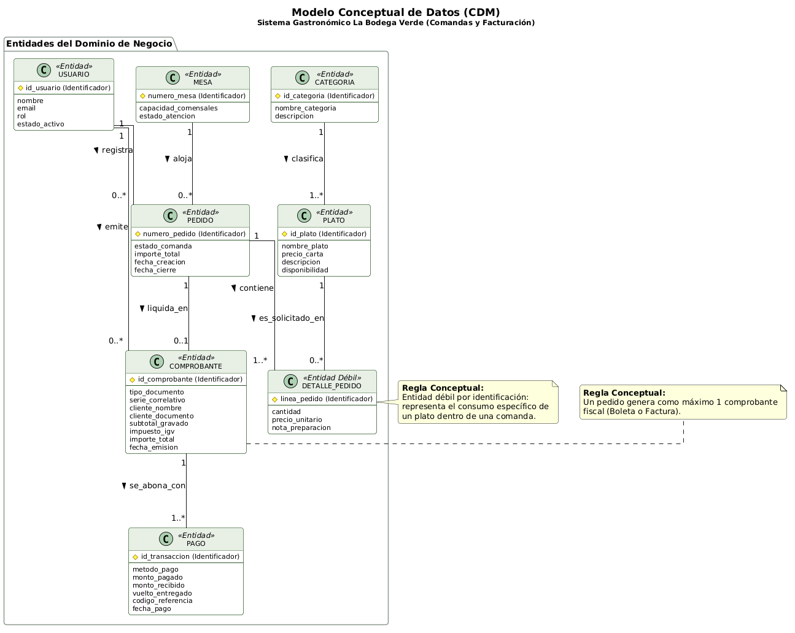
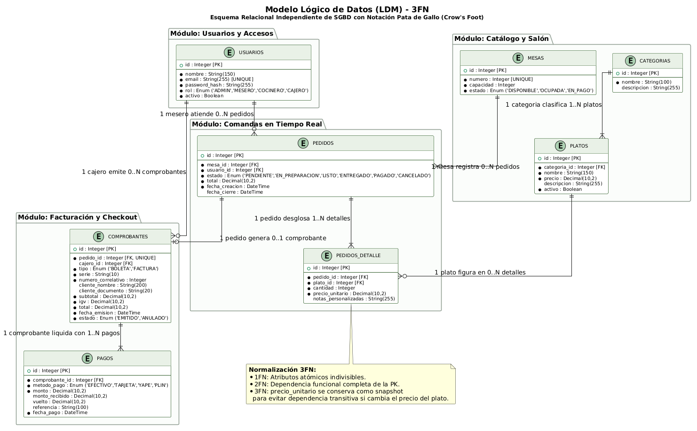
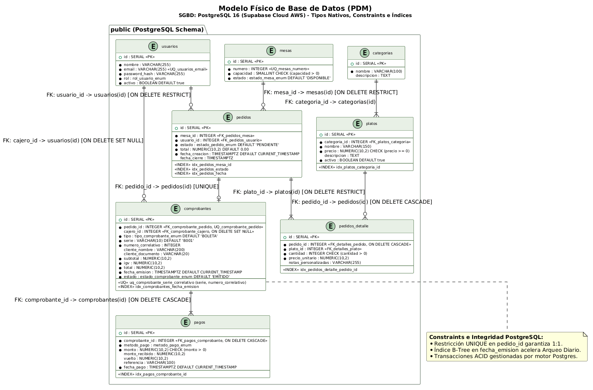

# 🗄️ Modelado de Base de Datos: Niveles Conceptual, Lógico y Físico
## Sistema Gastronómico — La Bodega Verde

El diseño de bases de datos relacionales para sistemas de información se fundamenta en la **arquitectura ANSI/SPARC de tres niveles de abstracción**. Esta metodología permite transitar de forma rigurosa desde los requerimientos del restaurante hasta la implementación tecnológica optimizada en el gestor de base de datos (**PostgreSQL 16 en Supabase Cloud**).

---

## 1. Cuadro Comparativo de los 3 Niveles de Modelado

| Criterio | 1. Modelo Conceptual (CDM) | 2. Modelo Lógico (LDM) | 3. Modelo Físico (PDM) |
| :--- | :--- | :--- | :--- |
| **Objetivo principal** | Capturar los requerimientos y reglas del negocio gastronómico. | Estructurar los datos en un esquema relacional normalizado (3FN). | Optimizar el rendimiento y almacenamiento en un SGBD específico. |
| **Audiencia** | Usuarios del restaurante, gerencia y analistas funcionales. | Diseñadores de base de datos y arquitectos de software. | Desarrolladores backend y administradores de base de datos (DBA). |
| **Dependencia del SGBD** | **Totalmente independiente** (no asume si es SQL o NoSQL). | **Independiente del SGBD** (asume modelo relacional genérico). | **Totalmente dependiente** (específico para PostgreSQL 16 / Supabase). |
| **Elementos clave** | Entidades, Atributos de negocio, Relaciones semánticas, Cardinalidades `(min, max)`. | Tablas, Columnas, Claves Primarias (`PK`), Claves Foráneas (`FK`), Tipos de datos lógicos. | Tablas físicas, Tipos nativos de Postgres, Índices B-Tree, Restricciones `CHECK`, `ON DELETE`. |
| **¿Contiene Llaves Foráneas?** | ❌ **No** (las relaciones se representan con verbos, no con atributos de enlace). | ✅ **Sí** (las FK materializan las relaciones entre tablas). | ✅ **Sí** (con acciones referenciales: `CASCADE`, `RESTRICT`, `SET NULL`). |
| **Notación gráfica** | Entidad-Relación clásica (Peter Chen) o Clases UML de negocio. | Pata de Gallo (*Crow's Foot*) en 3FN. | Diagrama físico relacional + Script DDL SQL. |

---

## 2. Nivel 1: Modelo Conceptual de Datos (CDM)

### 2.1. Propósito y Características
El **Modelo Conceptual** representa la estructura de la información tal como la concibe el negocio de *La Bodega Verde*, sin incluir detalles de implementación ni tipos de datos informáticos.

### 2.2. Elementos que lo componen:
1. **Entidades de Negocio:**
   - `USUARIO`: Persona que opera el sistema (Mesero, Cocinero, Cajero, Administrador).
   - `MESA`: Espacio físico del salón para atención a comensales.
   - `CATEGORIA`: Clasificación de la carta (Cafetería, Bebidas, etc.).
   - `PLATO`: Producto gastronómico ofrecido en el menú.
   - `PEDIDO`: Comanda u orden de consumo solicitada por una mesa.
   - `DETALLE_PEDIDO`: Entidad débil que desglosa los platos, cantidades y notas dentro de una comanda.
   - `COMPROBANTE`: Documento fiscal generado al liquidar la comanda (Boleta o Factura).
   - `PAGO`: Transacción financiera realizada por el cliente (Efectivo, Tarjeta, Yape, Plin).
2. **Atributos de Negocio:**
   - Únicamente nombres en lenguaje natural y su identificador conceptual (`# id_usuario`, `# numero_mesa`, etc.). **Sin tipos técnicos** como `VARCHAR` ni `INT`.
3. **Relaciones Semánticas (Verbos y Cardinalidad Conceptual `min..max`):**
   - *CATEGORIA* `(1,1)` --- **clasifica** --- `(1..*)` *PLATO*
   - *MESA* `(1,1)` --- **aloja** --- `(0..*)` *PEDIDO*
   - *USUARIO (Mesero)* `(1,1)` --- **registra** --- `(0..*)` *PEDIDO*
   - *PEDIDO* `(1,1)` --- **contiene** --- `(1..*)` *DETALLE_PEDIDO*
   - *PLATO* `(1,1)` --- **es solicitado en** --- `(0..*)` *DETALLE_PEDIDO*
   - *PEDIDO* `(1,1)` --- **liquida en** --- `(0..1)` *COMPROBANTE*
   - *USUARIO (Cajero)* `(1,1)` --- **emite** --- `(0..*)` *COMPROBANTE*
   - *COMPROBANTE* `(1,1)` --- **se abona con** --- `(1..*)` *PAGO*

### 2.3. Diagrama Conceptual



> Archivo local generado: [`modelo_conceptual.png`](file:///C:/Users/marti/Documents/Ciclo%209/Servicios%20Cloud/modelo_conceptual.png)  
> Código PlantUML: [`modelo_conceptual.puml`](file:///C:/Users/marti/Documents/Ciclo%209/Servicios%20Cloud/modelo_conceptual.puml)

---

## 3. Nivel 2: Modelo Lógico de Datos (LDM)

### 3.1. Propósito y Características
El **Modelo Lógico** transforma las entidades conceptuales en el **Modelo Relacional**, normalizado rigurosamente en **Tercera Forma Normal (3FN)**. Es independiente de la base de datos específica pero define la estructura de tablas, columnas y claves.

### 3.2. Justificación de la Normalización (3FN):
- **1ra Forma Normal (1FN):** Todos los atributos son atómicos (no hay grupos repetitivos ni arrays de platos dentro de un pedido; cada plato va en un registro individual de `PEDIDOS_DETALLE`).
- **2da Forma Normal (2FN):** Todos los atributos no clave dependen en su totalidad de la Clave Primaria (`PK`), no de una parte de ella.
- **3ra Forma Normal (3FN):** No existen dependencias transitivas. Por ejemplo, en `PEDIDOS_DETALLE` se registra `precio_unitario` como copia histórica del momento de la venta; los datos del plato (como nombre o descripción) no se duplican, sino que se acceden mediante la clave foránea `plato_id`.

### 3.3. Elementos que lo componen:
- **Claves Primarias (`PK`):** Identificadores unívocos lógicos (`id`).
- **Claves Foráneas (`FK`):** Atributos de enlace referencial (`categoria_id`, `mesa_id`, `usuario_id`, `plato_id`, `pedido_id`, `cajero_id`, `comprobante_id`).
- **Tipos de datos lógicos estándar:** `Integer`, `Decimal(10,2)`, `String`, `Boolean`, `DateTime`, `Enum`.
- **Notación de Pata de Gallo (*Crow's Foot*):** Expresa cardinalidad cero a muchos (`--o{`), uno a muchos (`--|{`) y uno a uno opcional (`--o|`).

### 3.4. Diagrama Lógico



> Archivo local generado: [`modelo_logico.png`](file:///C:/Users/marti/Documents/Ciclo%209/Servicios%20Cloud/modelo_logico.png)  
> Código PlantUML: [`modelo_logico.puml`](file:///C:/Users/marti/Documents/Ciclo%209/Servicios%20Cloud/modelo_logico.puml)

---

## 4. Nivel 3: Modelo Físico de Datos (PDM)

### 4.1. Propósito y Características
El **Modelo Físico** define la implementación real en **PostgreSQL 16 alojado en Supabase (AWS us-east-1)**, considerando tipos de datos nativos, integridad referencial en cascada, índices para acelerar búsquedas y optimización del motor.

### 4.2. Elementos específicos de PostgreSQL:
1. **Tipos de Datos Nativos:**
   - `SERIAL` / `INTEGER GENERATED ALWAYS AS IDENTITY` para llaves primarias autoincrementales.
   - `NUMERIC(10,2)` para cálculo monetario exacto sin pérdida de precisión por redondeo flotante.
   - `TIMESTAMPTZ DEFAULT CURRENT_TIMESTAMP` con zona horaria para auditoría de comandas y comprobantes.
   - `VARCHAR(n)` y `TEXT` con longitudes optimizadas.
   - Tipos `ENUM` nativos (`rol_usuario_enum`, `estado_mesa_enum`, `estado_pedido_enum`, `tipo_comprobante_enum`, `metodo_pago_enum`).
2. **Acciones Referenciales (ON DELETE):**
   - `ON DELETE CASCADE`: En `pedidos_detalle` y `pagos` para mantener consistencia si se borra una cabecera.
   - `ON DELETE RESTRICT`: En `mesas` y `usuarios` para impedir borrar mesas o meseros que tengan comandas históricas asociadas.
   - `ON DELETE SET NULL`: En `cajero_id` para preservar el comprobante fiscal aun si el usuario cajero es dado de baja.
3. **Índices de Rendimiento (PostgreSQL B-Tree Indexes):**
   - `idx_pedidos_mesa_id`: Búsqueda instantánea de comandas por mesa.
   - `idx_pedidos_estado`: Filtrado rápido para la pantalla de cocina (`PENDIENTE`, `EN_PREPARACION`).
   - `idx_comprobantes_fecha_emision`: Optimización de consultas para el **Arqueo Diario de Caja**.

### 4.3. Diagrama Físico



> Archivo local generado: [`modelo_fisico.png`](file:///C:/Users/marti/Documents/Ciclo%209/Servicios%20Cloud/modelo_fisico.png)  
> Código PlantUML: [`modelo_fisico.puml`](file:///C:/Users/marti/Documents/Ciclo%209/Servicios%20Cloud/modelo_fisico.puml)

---

## 5. Script DDL PostgreSQL (Implementación Física)

El siguiente código SQL corresponde a la creación física completa del esquema en PostgreSQL:

```sql
-- =====================================================
-- 1. TIPOS ENUM PERSONALIZADOS DE POSTGRESQL
-- =====================================================
CREATE TYPE rol_usuario_enum AS ENUM ('ADMIN', 'MESERO', 'COCINERO', 'CAJERO');
CREATE TYPE estado_mesa_enum AS ENUM ('DISPONIBLE', 'OCUPADA', 'EN_PAGO');
CREATE TYPE estado_pedido_enum AS ENUM ('PENDIENTE', 'EN_PREPARACION', 'LISTO', 'ENTREGADO', 'PAGADO', 'CANCELADO');
CREATE TYPE tipo_comprobante_enum AS ENUM ('BOLETA', 'FACTURA');
CREATE TYPE estado_comprobante_enum AS ENUM ('EMITIDO', 'ANULADO');
CREATE TYPE metodo_pago_enum AS ENUM ('EFECTIVO', 'TARJETA', 'YAPE', 'PLIN');

-- =====================================================
-- 2. TABLAS FÍSICAS CON CONSTRAINTS
-- =====================================================

-- Usuarios y Roles
CREATE TABLE usuarios (
    id SERIAL PRIMARY KEY,
    nombre VARCHAR(255) NOT NULL,
    email VARCHAR(255) NOT NULL UNIQUE,
    password_hash VARCHAR(255) NOT NULL,
    rol rol_usuario_enum NOT NULL,
    activo BOOLEAN NOT NULL DEFAULT true
);

-- Mesas del Salón
CREATE TABLE mesas (
    id SERIAL PRIMARY KEY,
    numero INTEGER NOT NULL UNIQUE,
    capacidad SMALLINT NOT NULL CHECK (capacidad > 0),
    estado estado_mesa_enum NOT NULL DEFAULT 'DISPONIBLE'
);

-- Categorías de la Carta
CREATE TABLE categorias (
    id SERIAL PRIMARY KEY,
    nombre VARCHAR(100) NOT NULL,
    descripcion TEXT
);

-- Platos y Precios
CREATE TABLE platos (
    id SERIAL PRIMARY KEY,
    categoria_id INTEGER NOT NULL REFERENCES categorias(id) ON DELETE RESTRICT,
    nombre VARCHAR(150) NOT NULL,
    precio NUMERIC(10,2) NOT NULL CHECK (precio >= 0),
    descripcion TEXT,
    activo BOOLEAN NOT NULL DEFAULT true
);

-- Pedidos (Comandas en Salón y Cocina)
CREATE TABLE pedidos (
    id SERIAL PRIMARY KEY,
    mesa_id INTEGER NOT NULL REFERENCES mesas(id) ON DELETE RESTRICT,
    usuario_id INTEGER NOT NULL REFERENCES usuarios(id) ON DELETE RESTRICT,
    estado estado_pedido_enum NOT NULL DEFAULT 'PENDIENTE',
    total NUMERIC(10,2) NOT NULL DEFAULT 0.00,
    fecha_creacion TIMESTAMPTZ NOT NULL DEFAULT CURRENT_TIMESTAMP,
    fecha_cierre TIMESTAMPTZ
);

-- Detalle de Pedidos
CREATE TABLE pedidos_detalle (
    id SERIAL PRIMARY KEY,
    pedido_id INTEGER NOT NULL REFERENCES pedidos(id) ON DELETE CASCADE,
    plato_id INTEGER NOT NULL REFERENCES platos(id) ON DELETE RESTRICT,
    cantidad INTEGER NOT NULL CHECK (cantidad > 0),
    precio_unitario NUMERIC(10,2) NOT NULL,
    notas_personalizadas VARCHAR(255)
);

-- Comprobantes Fiscales (Boleta / Factura)
CREATE TABLE comprobantes (
    id SERIAL PRIMARY KEY,
    pedido_id INTEGER NOT NULL UNIQUE REFERENCES pedidos(id) ON DELETE RESTRICT,
    cajero_id INTEGER REFERENCES usuarios(id) ON DELETE SET NULL,
    tipo tipo_comprobante_enum NOT NULL DEFAULT 'BOLETA',
    serie VARCHAR(10) NOT NULL DEFAULT 'B001',
    numero_correlativo INTEGER NOT NULL,
    cliente_nombre VARCHAR(200),
    cliente_documento VARCHAR(20),
    subtotal NUMERIC(10,2) NOT NULL,
    igv NUMERIC(10,2) NOT NULL,
    total NUMERIC(10,2) NOT NULL,
    fecha_emision TIMESTAMPTZ NOT NULL DEFAULT CURRENT_TIMESTAMP,
    estado estado_comprobante_enum NOT NULL DEFAULT 'EMITIDO',
    CONSTRAINT uq_comprobante_serie_correlativo UNIQUE (serie, numero_correlativo)
);

-- Transacciones de Cobro y Métodos de Pago
CREATE TABLE pagos (
    id SERIAL PRIMARY KEY,
    comprobante_id INTEGER NOT NULL REFERENCES comprobantes(id) ON DELETE CASCADE,
    metodo_pago metodo_pago_enum NOT NULL,
    monto NUMERIC(10,2) NOT NULL CHECK (monto > 0),
    monto_recibido NUMERIC(10,2),
    vuelto NUMERIC(10,2),
    referencia VARCHAR(100),
    fecha_pago TIMESTAMPTZ NOT NULL DEFAULT CURRENT_TIMESTAMP
);

-- =====================================================
-- 3. ÍNDICES B-TREE PARA ALTO RENDIMIENTO
-- =====================================================
CREATE INDEX idx_platos_categoria_id ON platos(categoria_id);
CREATE INDEX idx_pedidos_mesa_id ON pedidos(mesa_id);
CREATE INDEX idx_pedidos_estado ON pedidos(estado);
CREATE INDEX idx_pedidos_detalle_pedido_id ON pedidos_detalle(pedido_id);
CREATE INDEX idx_comprobantes_fecha_emision ON comprobantes(fecha_emision);
CREATE INDEX idx_pagos_comprobante_id ON pagos(comprobante_id);
```
